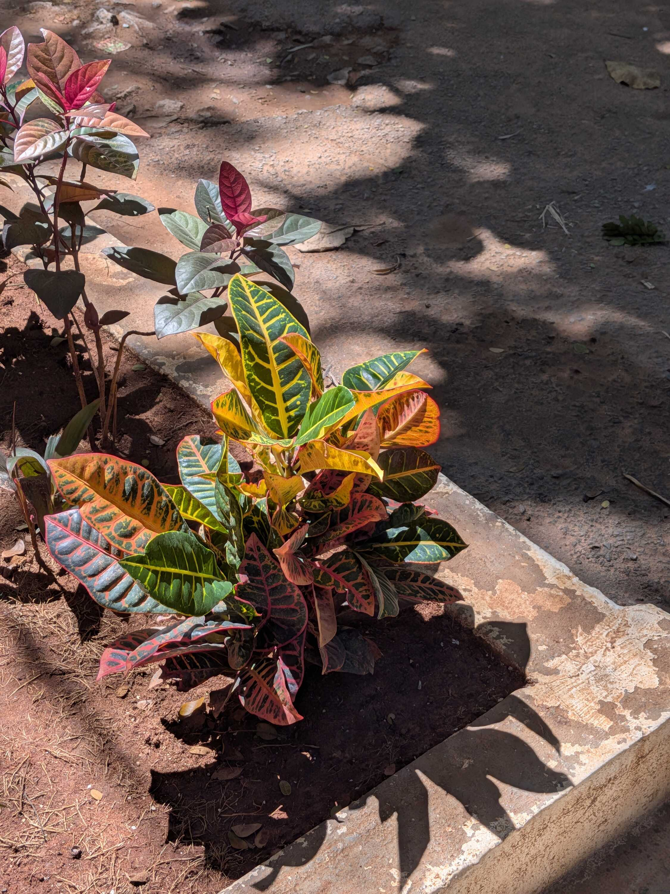
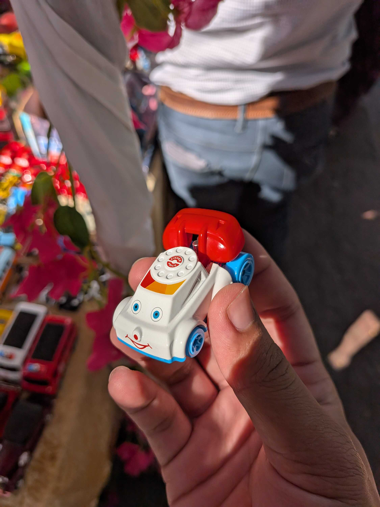
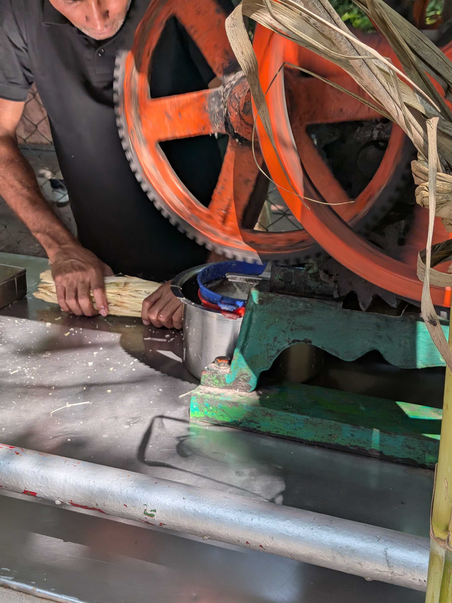
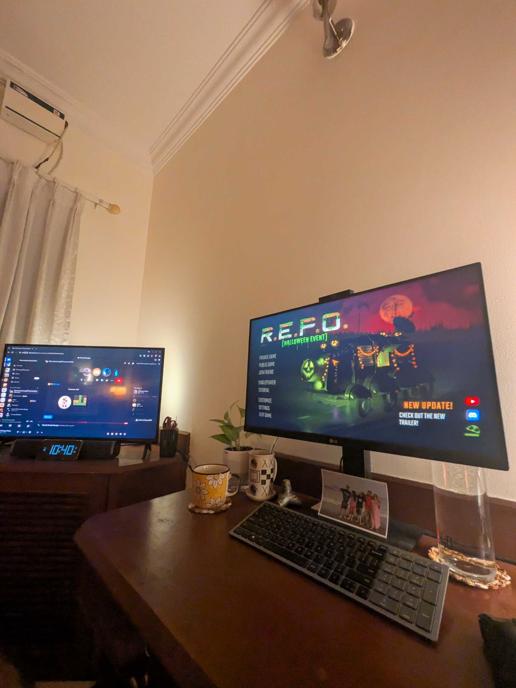

The start of the week continued in the same haze from [the previous week](/weeknotes/2026/43). Having fun when the ear is fine and mildly panicking when it started ringing. But I continued my medication religiously.

Sometime during the week, the tech park hosted a Halloween-based fair in the common area, with many different shops selling different things. I've learned I'm keen about handmade shiny things, cups/mugs with cool designs, and things with flowers on them. Not flowers themselves though, they make me sneeze.

I also found a telephone car thing, that looked very similar to a toy my sister had when she was little. A telephone she would drag around and its eyes would move up and down as its wheels spun. The tiny car was eerily similar, and I promptly sent a picture to my sister.

I also realized that I have had more _ganne ka juice_ (sugarcane juice) in Bangalore than I've had anywhere else. I don't even remember having it outside of Bangalore. My parents told me a lot about how they would eat sugarcane as kids, so maybe I'll tell them about the juice. They'll probably ask about the hygiene of the place that's making it.

Halloween approached as the month of October ended. I've not had a proper celebration of Halloween in my life, so it's just a Western event that passes over my feeds once a year. But I'm starting to feel like I want to know more about it.

It had more of an influence on me this year as [R.E.P.O.](https://store.steampowered.com/app/3241660/REPO/) -- the game I've been playing with friends -- got a big Halloween update that added more monsters and maps. I've said before that I'm not that interested in gaming, but something about doing difficult maps with friends has had me hooked recently. I've been dropping invites in the group to play almost every day.

That concludes this week. I genuinely, for the life of me, _cannot_ remember what I did on Saturday. There are zero photos from the day. I think I was just lying around.

But yeah, thank you for tuning into this regularly scheduled programming. Peace and love.

### Videos I Liked

- "[Fall Asleep While I Find a Needle in a Haystack](https://www.youtube.com/watch?v=X-CH15I5j6s)" by [sleepyslorgs](https://www.youtube.com/@sleepyslorgs)
- "[McKenna Grace Eats Her Last Meal](https://www.youtube.com/watch?v=F-u7fxt3d3w)" by [Mythical Kitchen](https://www.youtube.com/@mythicalkitchen)
- "[i rebuilt my totaled car alone in my driveway](https://www.youtube.com/watch?v=_lGyHqbhK-A)" by [Abhi Velaga](https://www.youtube.com/@abhi.velaga)
- "[will switching to this dumbphone ruin my life](https://www.youtube.com/watch?v=w0MaXtEeAdc)" by [Danny Gonzalez](https://www.youtube.com/@danny-gonzalez)
- "[ASMR massage | Phoebe Bridgers ⭐️](https://www.youtube.com/watch?v=Q_050nEIMqw)" by [itsblitzzz](https://www.youtube.com/@itsblitzzz)

### Posts I Loved

- "[How to Capitalize Hyphenated Words in Titles and Headings](https://erinwrightwriting.com/capitalize-hyphenated-words-in-titles-and-headings/)" by [Erin Wright](https://erinwrightwriting.com/)
- "[Doing nothing at work](https://www.seangoedecke.com/doing-nothing-at-work/)" by [Sean Geodecke](https://www.seangoedecke.com/)
- "[The AI writing witch hunt is idiotic](https://www.joanwestenberg.com/p/the-ai-writing-witch-hunt-is-idiotic)" by [JA Westenberg](https://www.joanwestenberg.com/)

### Links I Found Cool

- [Logs from Lille Ø](https://lille-oe.de/)
- [My Old GitHub README Profile](https://githubprofile.com/templates/AbhigyanTrips)
