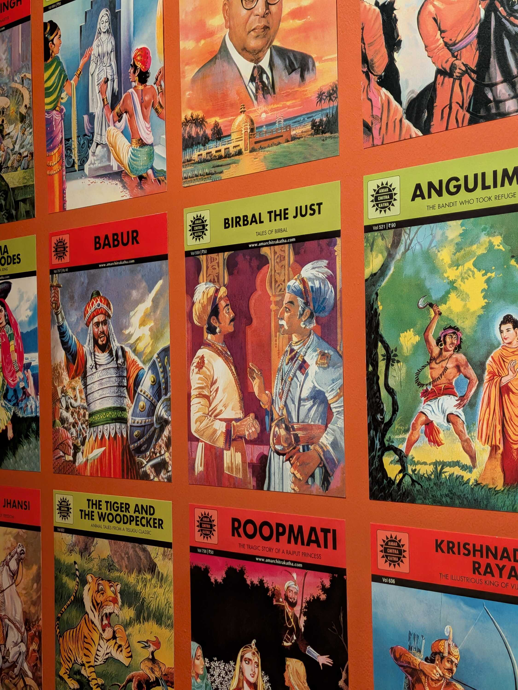
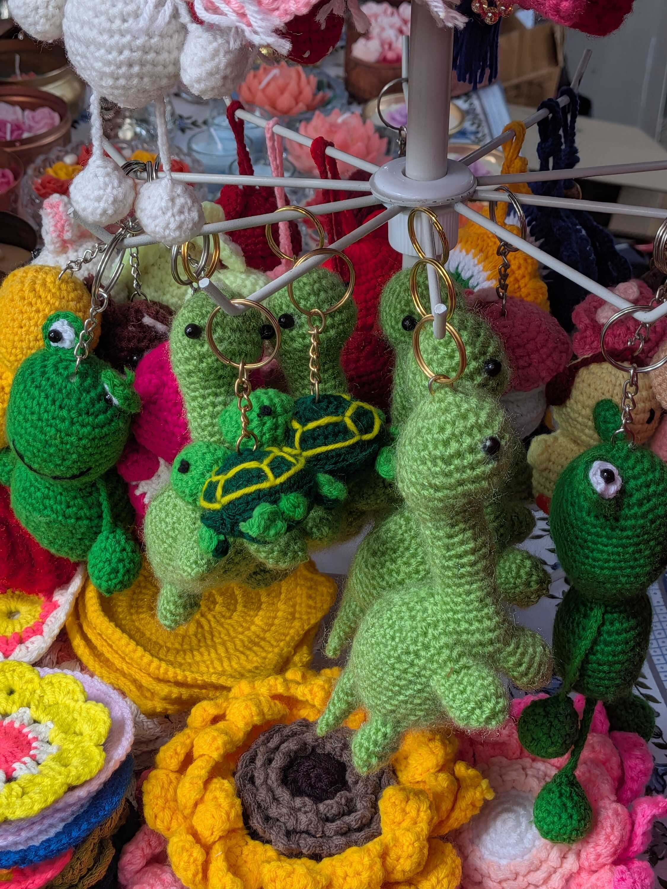

On Sunday, I went for a set menu lunch at Bistro Cameo with [Tanvi](https://tanvibhakta.in/), [Santrupti](https://santruptip.in/) and [Anik](https://www.anikthink.com/).

When having food at a new place, I either decide to be experimentative or try and find the closest alternative to my comfort foods. This time I chose the former.

My lunch hence comprised of a soup with coconut in it, a cocktail with yoghurt in it, and other things that my mother would laugh at me for getting knowing how picky I am. But I ate everything properly! And the desserts we ended with kinda made up for anything I had before. I was a happy man with a full stomach.

I only learned after reaching Bistro Cameo that it was on the top floor of [MAP](https://map-india.org/). So after a full lunch and hearty desserts, we went down to first revisit "[A Moving Line](https://map-india.org/exhibition/a-moving-line-1500-years-of-indian-visual-storytelling/)" as a part of a tour, and then quickly caught up with "[Grip, Hold, Pin](https://map-india.org/exhibition/grip-hold-pin/)"; where the tour was being provided by the curator themselves.

Revisiting "A Moving Line" was wonderful, because I got to walk and be surrounded by so many different stories told visually with careful lines and expressive speech balloons. My eyes were never bored in that room. I even read some Tintin in Hindi.

I was lucky to visit "Grip, Hold, Pin" when I did too, because it was the last day of the exhibit from what I can remember. The walkthrough group absorbed [Aayati](https://www.linkedin.com/in/aayati-sengupta-157247a6/)'s insights into different parts of the collection quietly, and we continued to gaze at the pictures and note our favourite details. I think I learned a lot about Indian wrestling culture from those (fantastic and well-timed) static frames.

Both the tech park and the office this week were decked out with decorations for Diwali. The office was having a bunch of different competitions that people participated in, and I spotted a beautiful _rangoli_ made during a competition -- a peacock with the company logo on a **gradient** background.

A teammate of mine also participated in the talent show, and I enjoyed cheering for them and recording the performance for the rest of the team. As the week progressed, the office grew emptier and more people went home for the holidays. Including me. :)

As I write this weeknote in retrospect, I'm at home sitting in a familiar chair, watching anime on a familiar TV. Life is good. And a bit polluted, but more on that in the next weeknote.

There were _a lot_ of links shared in the [IndieWebClub](https://blr.indiewebclub.org/) WhatsApp group recently, and I now have dozens of messages I have forwarded to myself to view later. This note has some of them that I think you should visit too. With that, happy holidays!

### Videos I Liked

- "[Hermitcraft 9: Episode 46 - COVERING THE PERIMETER](https://www.youtube.com/watch?v=41BYvUu4OBA)" by [Grian](https://www.youtube.com/@Grian)
- "[I Played MF DOOM at a Gujarati Sweet Shop](https://www.youtube.com/watch?v=dR46aeCZZ7k)" by [Mihir's Radio Room](https://www.youtube.com/@mihirsradioroom)

### Posts I Loved

- Dave Gauer ([Ratfactor](https://ratfactor.com/))'s [Inktober 2026](https://ratfactor.com/inktober26/)
- "[Imagine: Free(dom) software version](https://journal.jatan.space/imagine-free-software-version/)" by [Jatan](https://journal.jatan.space/)
- "[Working Stiff](https://vasanthx.substack.com/p/working-stiff)" by [Vasanth](https://vasanthx.substack.com/)
- "[Not an Inherited Feast: The Modest Archives of my Mother's Kitchen](https://www.goya.in/blog/not-an-inherited-feast-the-modest-archives-of-my-mothers-kitchen)" by [Sonali Verma](https://www.instagram.com/notsonali/) on [Goya](https://www.goya.in/)
- "[The Golden Age](https://dark.ronacher.eu/2026/10/31/golden-age/)" by [Armin Ronacher](https://ronacher.eu/)
- "[Bread is life](https://bogas04.fyi/blog/2026/11/bread-is-life/)" by [Divjot](https://bogas04.fyi/)

### Links I Found Cool

- Ryan Barrett's [Snarfed.Org](https://snarfed.org/)
- [Don Marti's Blog](https://blog.zgp.org/)
- [The Internet Movie Cars Database](https://www.imcdb.org/)
- [QuantifiedSelf.Com](https://quantifiedself.com/) -- "Personal science is for everyone"
- [The Useless Web](https://theuselessweb.com/)
- [The Pudding](https://pudding.cool/) (My GOAT)
- [The Radio Garden](https://radio.garden/) (Another GOAT)
