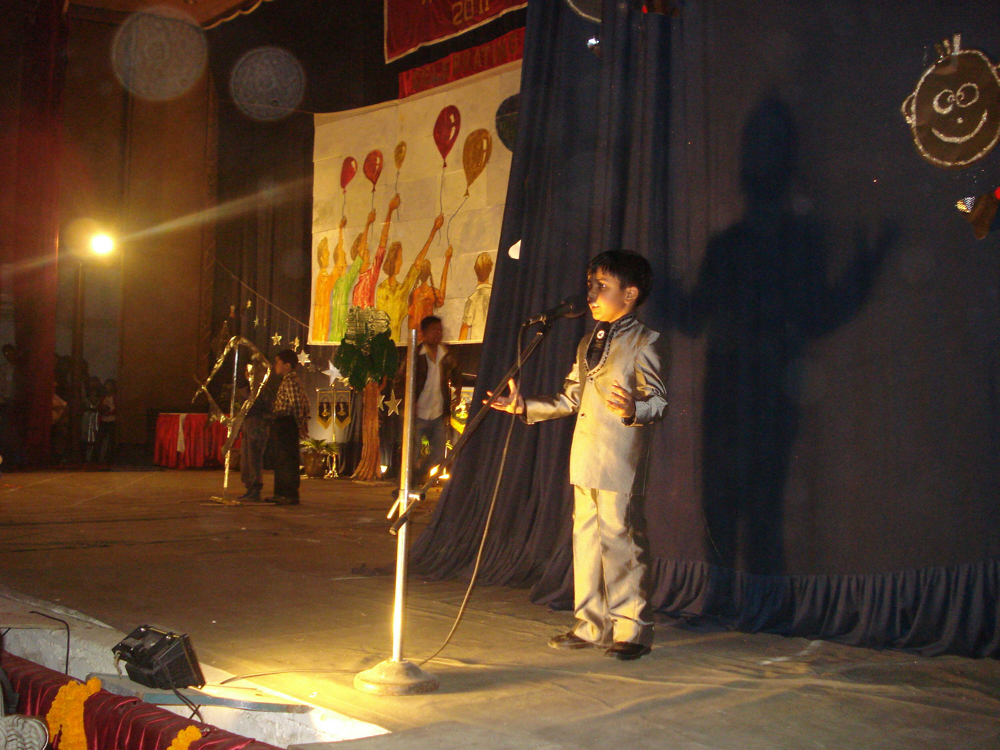
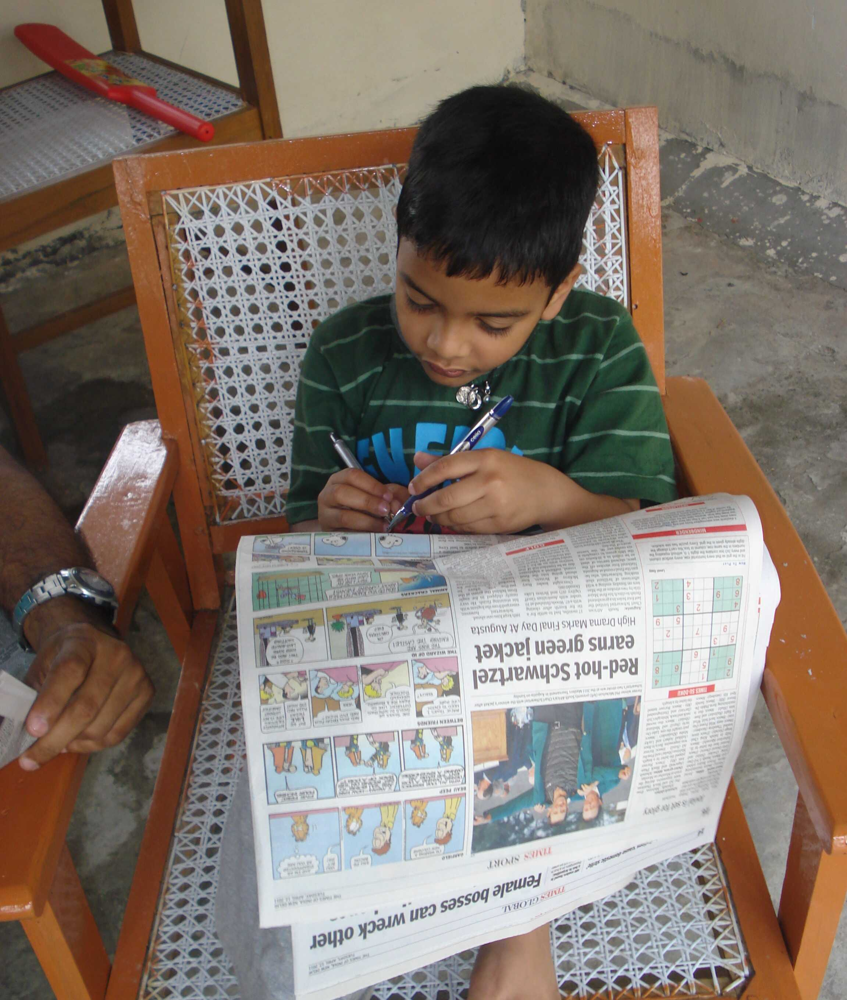
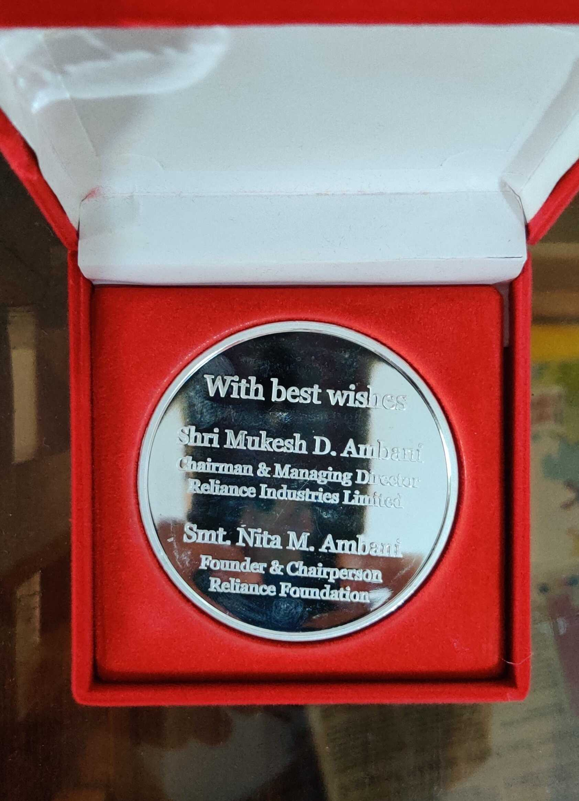
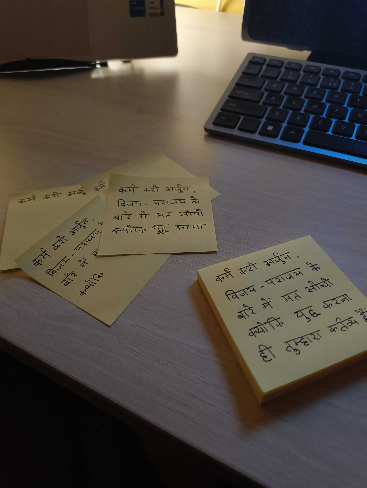
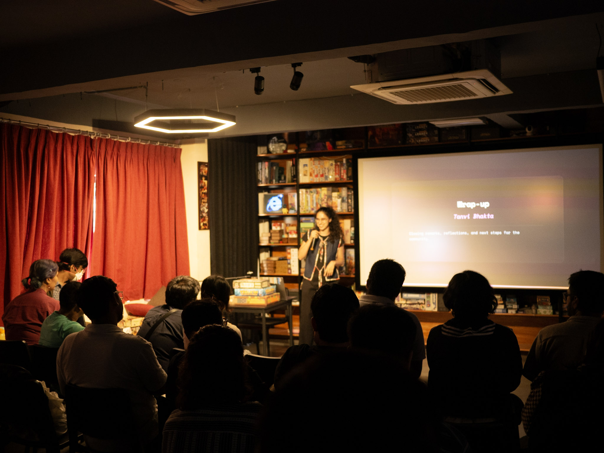

I'm currently in an ongoing, self-imposed writing crunch, where I've told myself that I won't share any blogposts (and revel in the subsequent attention) until I finish all my drafts.

This has led me to scratch my head and stare into space for hours, at this point. I've even stayed up till 2AM sometimes to try and phrase things a certain way; gone back and forth between different wording structures, and even sometimes said, "to hell with it," and pressed publish right before going to sleep. That last one would be considered maniacal by some people, and I would gratefully agree.

You're probably wondering _why_ I am doing this to myself. I am too. The short answer is that I don't know. But you can watch me grapple with the long one below.

I have been doing communicate-y things for a _long_ time. From narrating a school play in 5th Grade to hosting large events in college. I like to put my scrambled thoughts out into the world and see how people react to it. Not all reactions bring me joy, but more often than not I'm glad that the thoughts are out there and not left with me.

I'm sure it was a not-so-gentle push by my parents for me to attend all these oration and debating competitions -- side effects of [being an army brat](/whoami/an-army-brat/) -- but over time I developed a taste for it. Preparing my words, memorizing them while walking in circles, and then finally presenting them on a stage. I can't remember if I had an urge to win; in most cases the attention I received was enough. But that is the root of my journey.

Writing was almost always a side-effect. Pen and paper were the omnipotent tools of the school student, and what you wrote with/on them was completely up to you. The 5-mark answers with the blue pen made a semi-permanent callus on my ring finger, and that callus made it easy for me to write for even longer.

One of these essays -- one that stuck with me heavily -- was Reliance's Drishti Essay Competition in 10th Grade. A nation-wide event with the promise of great recognition in its advertising. The habit of participating superseded any hesitation to apply, and soon I was sitting in front of an empty page in the classroom with a prompt written in front of me.

  "India — Land of Joy"

I don't remember racking my brain over the prompt much. I just wrote a few long pages about how my dad's unique profession (did I mention I'm an army brat?) gave me the opportunity to look at different cultures and see how they all thrive and live together within the same borders. I might have written something about how seeing it all shows you why the country is worth protecting, I don't know. Maybe I should look for that essay again.

I didn't expect to hear back about the essay, until I did. An announcement followed by much applause in the Assembly Hall. A silver medal received from the Principal. My name was printed alongside many in Reliance Foundation's Annual Diary that year, and my mom has kept it safely with her as a memento since.

The attention from it all was temporary, as it always is. But the takeaway I had from the event -- the one that my reason to write revolves around -- is _resonance_.

I remember hearing somewhere that a casual remark or a passing comment from one person can cause a deep shift in another without the intention to do so. I have experienced moments like these myself, some of which [I document here](/snippets), so I can tell it's true. And while I don't always pass remarks as casually as a fart, I can imagine that other people collect unintended snippets from my writing too.

That, really, is my main reason to write publicly. To leave my thoughts in a place where other people can pick them up, read through them, and maybe find something that sticks with them.

And I can tell it works, because lot of the posts here that have gotten love have been ones that weren't aiming to be read:

1. My post about [lo-fi tech that excites me](/blog/calm-technologies) was primarily a collection/shopping list for me to look back on in the future, but it somehow reached around 40 thousand views per the anonymous analytics. It spawned enthusiastic comments on forums like [Lobste.rs](https://lobste.rs/s/fmyrgy/calm_technologies_excite_me) and [Hacker News](https://news.ycombinator.com/item?id=49032382), and ended up in people's inboxes through many newsletters. The post also got me added to [Kagi's SmallWeb](https://kagi.com/smallweb), which I'm grateful for,
2. My [letter to my college juniors](/blog/to-my-college-juniors) stemmed from many juniors reaching out to me with their troubles, all revolving around what they were facing in college. The letter was my effort to provide a response worthy of their collective time,
3. My posts about the protests of [July 20th](/blog/a-prayer-for-the-cockroaches) and [October 10th](/blog/favourite-art-from-october-10) were an effort to show dissent in a place where it could reach other people without being [forcefully](https://internetfreedom.in/addressing-content-blocking-on-social-media/) [shut](https://internetfreedom.in/iff-statement-against-the-alarming-escalation-of-social-media-censorship-and-proposed-expansion-of-takedown-powers/) [down](https://internetfreedom.in/iff-statement-on-delhi-police-notices-to-meta-seeking-the-identities-of-creators-and-the-continuing-removal-of-cjp-protest-content-from-instagram/) by the State, and,
4. [My weeknotes](/weeknotes) remain a place where every week of my life leaves a footprint -- an evidence that I was there and did something in it -- which also happens to give bits of joy to people when they read it and sometimes find their names in it.

Another reason, which that last point brings up, is the urge to archive everything.

I, hopefully like everyone else, worry about death from time to time. In that worry, I sometimes wonder if I might die with some final wise words left unsaid that could have left one last resonating wave. An instance of the Butterfly Effect left undiscovered for the worse.

I can tell this is a little much, because I have sometimes mentioned leaving my domain name or my web bookmarks or my <abbr title="'To Be Read' List">TBR</abbr>/<abbr title="'To Be Watched' List">TBW</abbr> as a part of my will, and seen people's eyes widen with an unconvinced, "Sure, okay." It might be a little eccentric, but I'm the same person who once took a junior's comment about my writing being "idiosyncratic" as a compliment, so I'm okay with it.

There are other tiny reasons that orbit around these principles too, ofcourse. My public blogging era began because I was sick of my profession and my hobby both being programming, and needed to do something that _wasn't_ writing code. God might have listened to me too well on that front, because even programming work mostly revolves around writing normal sentences right now.

The other, final, last-but-not-the-least, cherry-on-top reason, is just [IndieWebClub](https://blr.indiewebclub.org). A community that attracts the writers, the tinkerers and the curious. People who keep doing cool new things and like to talk/write about it. There's always so much to learn and consume, and all of it leads to my wish to write even more and give back. To share my thoughts that came from their thoughts. To talk and laugh and learn.

I hope we, as people, find more communities and third places like that for ourselves. That we find more places to dance and talk and mingle. More places to find other people. Because all writing, even when benefiting oneself, is still for other people.

It's about 4AM as I write this. Eyelids are getting heavier but I'm also getting slightly hungry. Wouldn't it be funny if I just post it and sleep? The blog will come full-circle and all that. Fine fine, I'll edit and post tomorrow. Peace and love.
