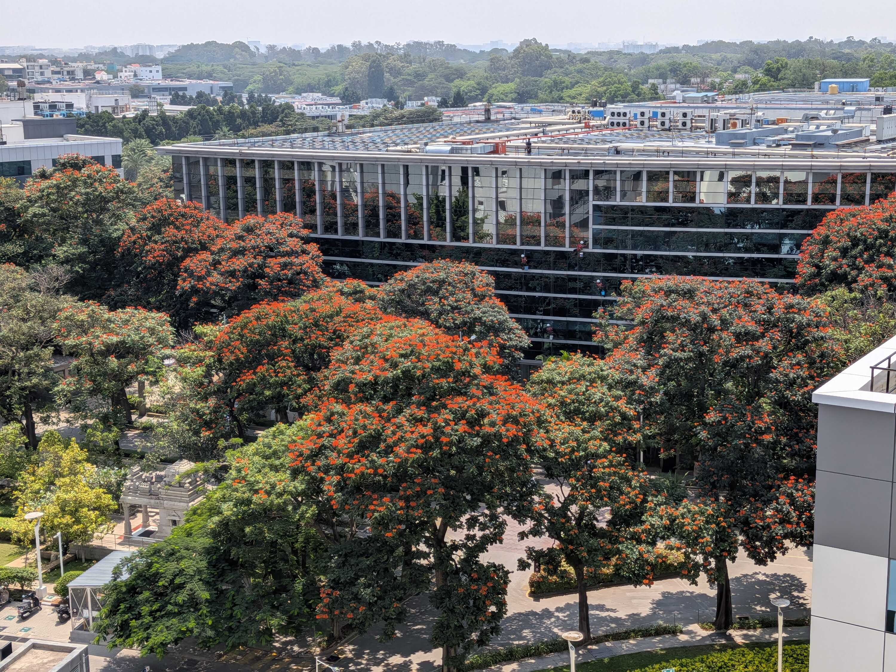
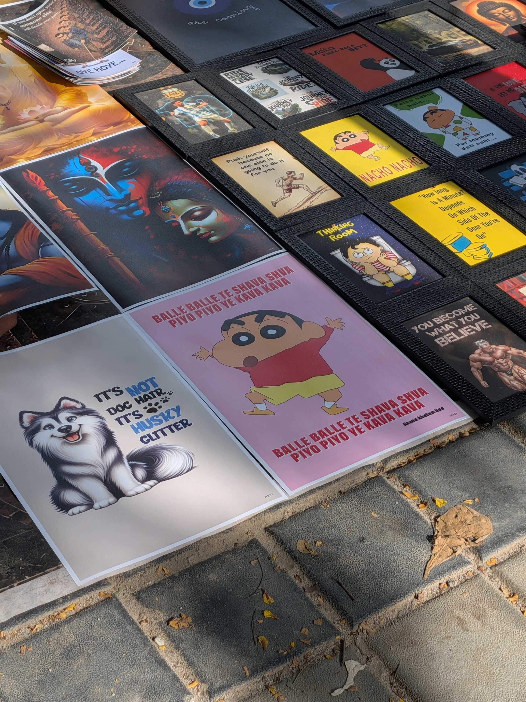
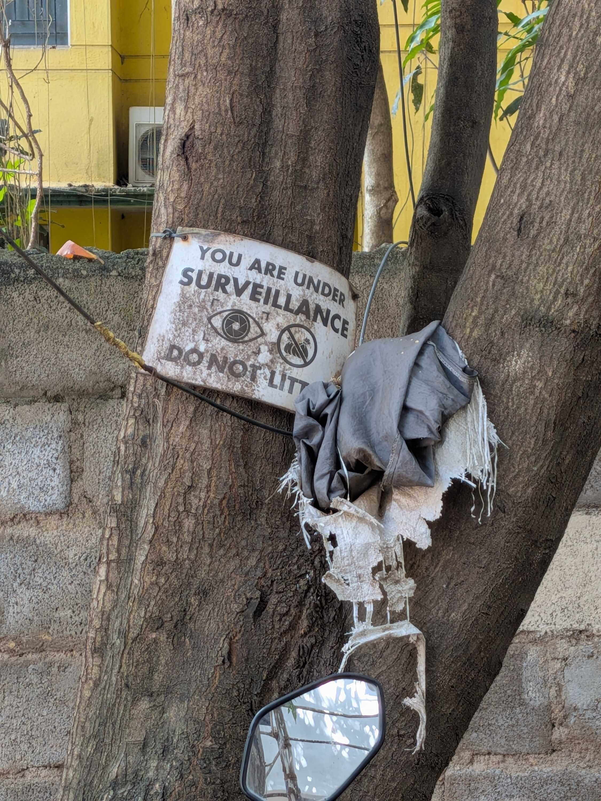
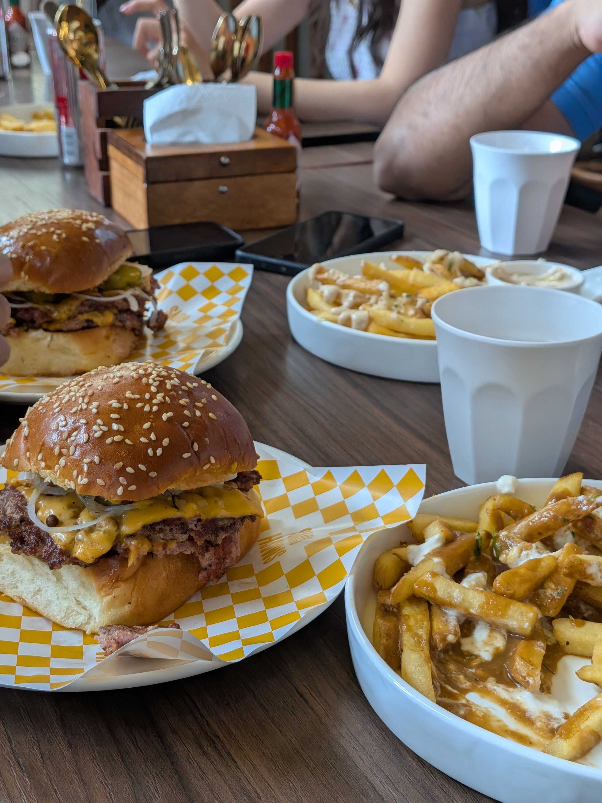
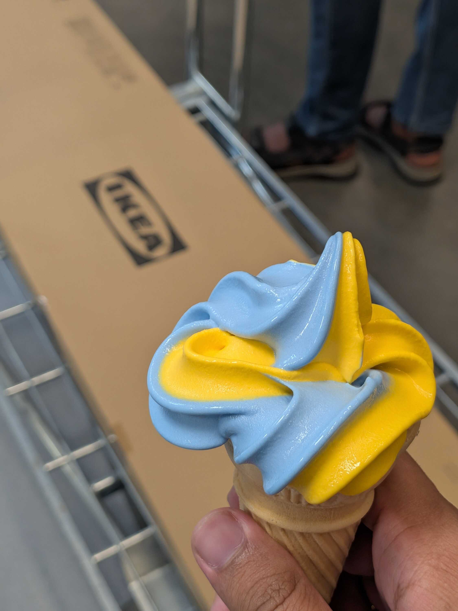
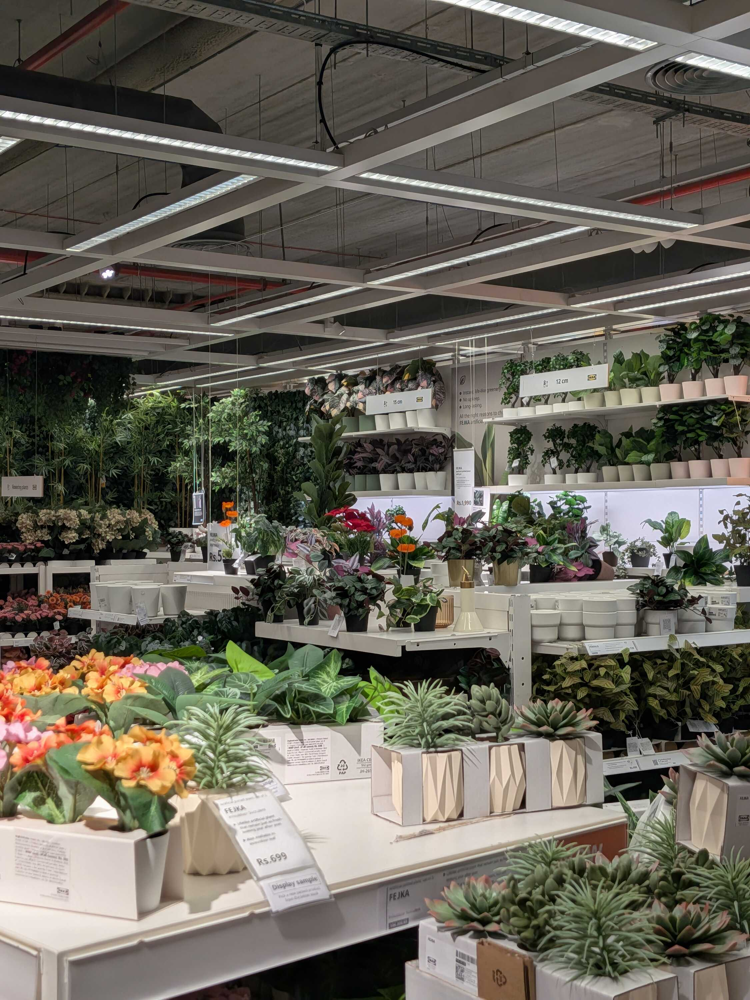

The workdays felt _extremely_ long this week.

A lot of non-coding tasks lined up and joined forces with a deadline. I'm not particularly against documentation -- I quite like it in fact, since I like to write -- but reaching the finish line definitely felt slower than it does for programming tasks. I most likely have just gotten used to the speed of LLM's though, which is a scary thought.

In other news, I met a batchmate from college who just started interning in the same company. We bumped into each in the cafeteria and kinda went, "You look familiar," and our current assumption is that we must've seen each other on LinkedIn or somewhere else. We caught up on our life events and placement shenanigans since college, and my cafeteria breaks passed by a little bit faster.

Walking around the tech park after lunch has made me think a lot about air conditioning recently.

I see these huge office buildings, their rooftops brimming over with AC units and backup generators and even some solar panels. Going to any balcony close enough to them will have you witness a low and consistent hum all throughout the day. Heaps of heat constantly dissipating from the tops of these buildings.

I remember going to Goa and looking at the shape of a beach on the map; how a small "C" shape on the screen was a _really_ big area in-person. And as I realize the scale of the Earth more and more, and see the collateral from a single building, I keep thinking, "We must _really_ be hurting the Earth for it to be getting _worse_."

I start thinking about the landfills and the water pollution, the factories and the data centers. All of the hurt and neglect stacking up. I spend some time in that hopelessness, before a coworker taps me on the shoulder and asks me if I want ice-cream.

Bangalore weather has reached that weird point where I can't figure out whether to sleep with the fan on or off. It gets too cold by the time I wake up, and I have to do the healing shenanigans for a scratchy throat/runny nose.

Afternoons still seem pretty hot though, with the Sun blazing over any part of the tech park not covered by tall glass structures. The fluctuation is weird. I saved a meme in this context, that I'd like to share here:

> "its 85 degrees in october because you guys can't stop asking chat gpt to make y'all fuckass flyers"

Is it really a meme if it's true?

News around the [SIR protests](https://en.wikipedia.org/wiki/2026_Indian_electoral_controversy) gained volume towards the end of the week. Visuals of brutality and censorship made their rounds on the social media algorithms in the thousands. A close repetition of the events from the [NEET protests](https://en.wikipedia.org/wiki/2026_NEET_controversy) in July, except you could tell the State was more prepared this time.

When I [last wrote about the NEET protests](/blog/a-prayer-for-the-cockroaches), I remember being in despair over the treatment towards the students. I kept track of the events from afar, and even reposted reels and the like on my Instagram Stories; I'm not sure why, but most likely to find solace in sharing what I was seeing with everyone else.

I remember feeling intense relief when the resignation of the Education Minister was finally announced. "They'd won," was how I thought about it back then. The feelings have gotten more mixed since then, which is something I have written a bit about (but that draft is still rotting unpublished).

Anyway, I had all this floating around in my head when I went for a swim with <abbr title="My friends from college, where most of the group is Marathi. I don't really know how we ended up on that term, but that's how we refer to the group now.">Marathi Gang</abbr>, and the conversation in the cab afterward volitionally turned to the events of the SIR protest.

There was (surprisingly) much doubt and pessimism around the effect of the protest and its ability to actually mitigate the "root cause" of the current power situation. I shared my thoughts and we all had a healthy back-and-forth. I'll gloss over the details of the discussion, but what I learned at the end is that I was actually _hopeful_ about the future of it all.

Once again, I really wish my draft for this was already up. But I believe the actual "victory" of the Cockroach Janta Party protests was that they started a chain of dissent. They showed people that they _can_ get up and say "No, you cannot treat me like this. I'm not an inanimate metric on your tenders and flyers. I'm a living, breathing citizen."

The people who had tolerated bad policies and procedures could now feel connection, could see that there are other people facing the same "bad" and are not happy about it. They're now giving themselves the permission to speak up. They're allowing themselves to say, "No, you cannot treat me like this. I get hurt by your political neglect and feel sorrow when people around me get hurt by it too."

There's a lot of pent-up rage flowing through the masses and their actions right now. All of it understandably so. The State might be able to summon enough _lathis_ today to try and curb it all, but over time they _will_ have to admit their faults and change. And, in the long run, it is _us_ that will form the next wave of leadership. It is _us_ who will use the coffers full of _our_ tax money to bring the progress we were promised. We will do all that, pinky promise.

Now don't be mad, but this was my first time having food at Smash Guys. And I'm shook by my own neglect of this place. The food was so good (and so filling) that I had to stare at the ceiling once I was done just to recuperate. I noticed similar reactions from the rest of Marathi Gang.

I probably should experiment with going to more new eating places (by which I still mean the well-tested ones). I'm yet to go to Paris Panini, for example. And I didn't go to Corner House until a couple years ago, even though I've been in Bangalore for a little over four years. There seem to be many new things to try, and that's always exciting.

Once we finished our food, we got into the metro and began our looong journey to reach Ikea for some friends that were furniture-shopping.

It had been a couple years since I last went to Ikea in Bangalore; reaching it is no easy feat anyway, since it's over an hour away from Indiranagar. But the big blue warehouse and the layout inside was almost exactly as I remembered it.

We first got a (non-alcoholic!) beer from the restaurant, and then began our journey of loitering around in the Ikea Showcase. We tested out multiple sofas and cooked a lot of <abbr title="It's 12AM so I can't come up with a better definition, but consider it a desi version of daydreaming.">_khayali pulao_</abbr> around our future home interiors. At one point a grandma saw the bottles we were holding and gave us a bombastic side-eye, so we promptly started looking for a dustbin for the beers.

After a swim, a heavy lunch and a long travel, going through the bedroom section of the Ikea Showcase was probably not a good idea. I remember sitting down on a bed and thinking, "Well, I can't get up now." We looked for the most uncomfortable bed we could after that, to sit down and plan our ~escape~ route to our intended shopping interest.

After another 30 minutes of stumbling through the showcase to reach the Lighting section (and taking picture of things we found cool along the way), we learned that the one thing a friend wanted to buy was out of stock. Once the rep helpfully pointed out that we can order it from the website, we trudged along to the second restaurant for a break.

We had our (unlimited refill!) drinks and chocolate croissants. We went out to the sign, took pictures, and started to leave towards the metro entrance. On our way out, I spotted the pillar where my school friend had crashed her cart the last time we were here, and that made me smile.

---

I took the long metro ride home and that, my lovely readers, is where this weeknote ends. I missed out on [Maya Bazaar](https://mayabazaar.co.in/home) this weekend due to other plans and general energy level, but I hope I can attend it next time. So many things to look forward to.

Peace and love.

### Videos I Liked

- "[Hospice Nurse Julie Eats Her Last Meal](https://www.youtube.com/watch?v=qP8HVVLll1w)" by [Mythical Kitchen](https://www.youtube.com/@mythicalkitchen)
- "[Dear DK, flyover yaake?](https://www.youtube.com/watch?v=ya48BXvse8k)" by [Bengawalk](https://www.youtube.com/@bengawalk)
- "[Delay Lama - The Less I Know The Better](https://www.youtube.com/watch?v=e22BDN1My9A)" by [SämSolutions](https://www.youtube.com/@samsolutions_og)
- "[the rhythm everyone knows](https://www.youtube.com/watch?v=F6tz5TduutI)" by [Synthet](https://www.youtube.com/@synthet7)
- "[jailbreaking the lululemon mirror](https://www.youtube.com/watch?v=_0gtiMi5AzI)" by [jvscholz](https://www.youtube.com/@jvscholz)
- "[Good Morning India - Go Back To Sleep](https://www.youtube.com/watch?v=bE9rxrjAnxc)" by [Samdish & Team](https://www.youtube.com/@UNFILTEREDbySamdish)

### Posts I Loved

I read so many absolute BANGERS this week. People write so damn well.

- "[Is this what ageing feels like?](https://nihalsahu.net/ageing/)" by [Nihal Sahu](https://nihalsahu.net/)
- "[Getting a job after 10 months of unemployment](https://santais.online/blogging/blogs/10months-unemployment)" by [Santrupti](https://santais.online/)
- "[A Day in My Life](https://abhinavsarkar.net/notes/2026-day-in-life/)" by [Abhinav Sarkar](https://abhinavsarkar.net/)
- "[A Day in My Life](https://anexasajoop.in/blog/a-day-in-my-life/)" by [Pooja Saxena](https://anexasajoop.in/)
- "[how to sleep](https://atharvaraykar.com/how-to-sleep/)" by [Atharva Raykar](https://atharvaraykar.com/)
- "[My impossible bucket list](https://bogas04.fyi/blog/2026/10/my-impossible-bucket-list/)" by [Divjot](https://bogas04.fyi/)
- "[A.I. Shortcuts Are Ruining How We Think](https://www.nytimes.com/interactive/2026/09/27/opinion/ai-art-creativity.html)" by Giorgia Lupi on [The New York Times](https://www.nytimes.com/) ([Archive Link](https://archive.is/IHq6q#selection-3669.3-3669.15))
- "[How the Lobsters front page works](https://atharvaraykar.com/lobsters/)" by [Atharva Raykar](https://atharvaraykar.com/)
- "[How to steal my work](https://annaluciawrites.substack.com/p/how-to-steal-my-work)" by [Anna Lucia](https://substack.com/@annaluciawrites)
- "[An education in the age of automation](https://kenneth.dsouza.im/writing/an-education/)" by [Kenneth D'Souza](https://kenneth.dsouza.im/)

### Links I Found Cool

- "[There Are No Gardens on the Internet](https://artlab.hyundai.com/commissions/chia-amisola-there-are-no-gardens-on-the-internet)" by [Chia Amisola](https://amiso.la/)
- Pirijan's Website, [PKeth.Org](https://pketh.org/)
- "[Destroy Any Website](https://destroy.spritefusion.com/)" by [Sprite Fusion](https://spritefusion.com/)
- [Ankur's Old Archived Blog](https://archive.ankursethi.com/)
