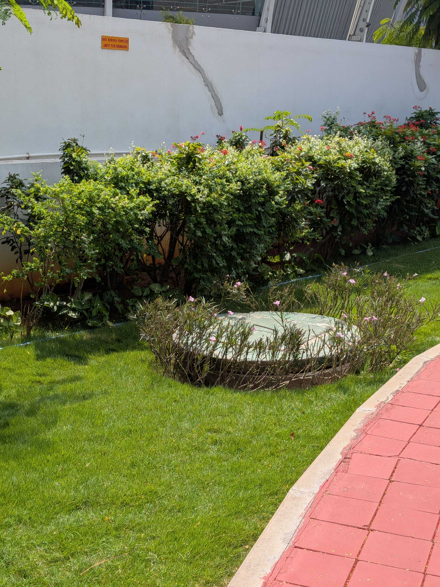
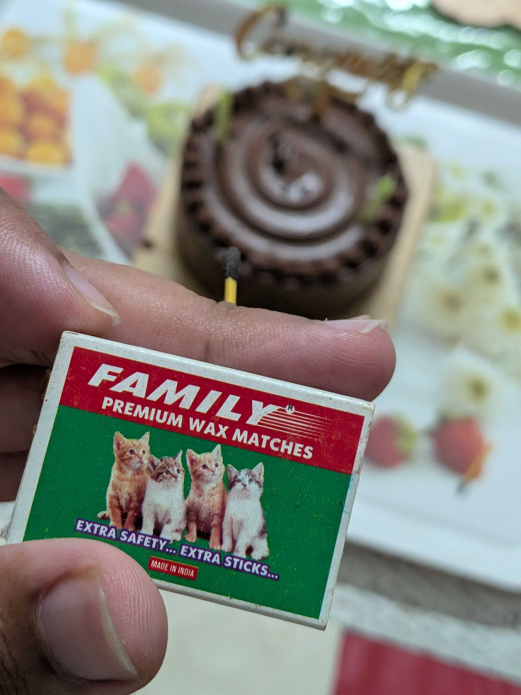
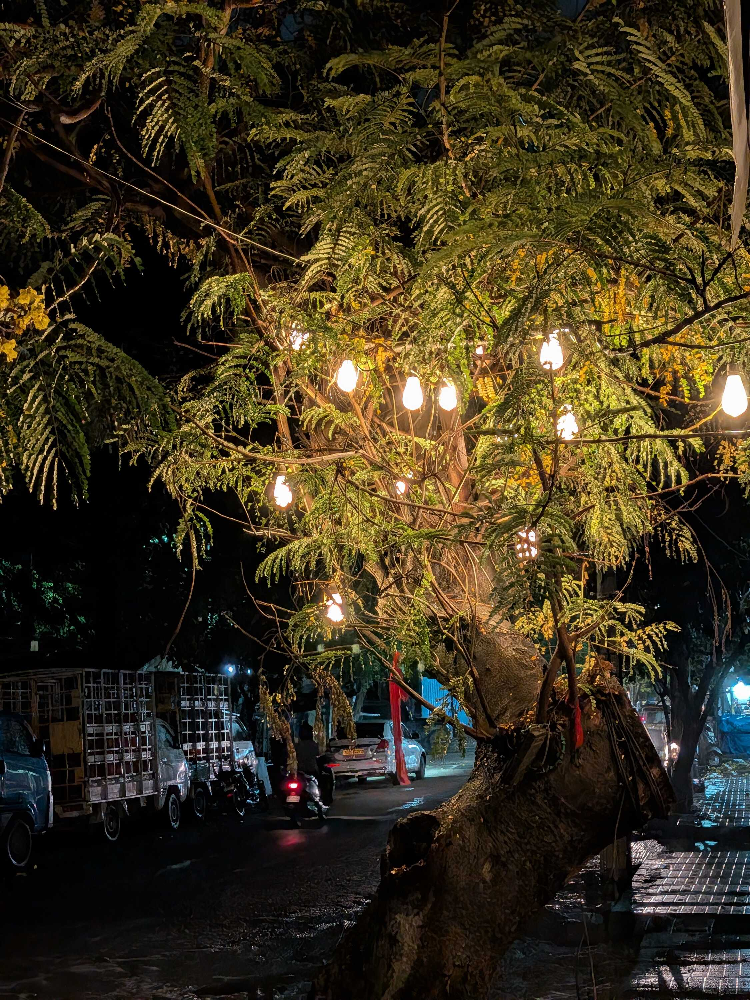
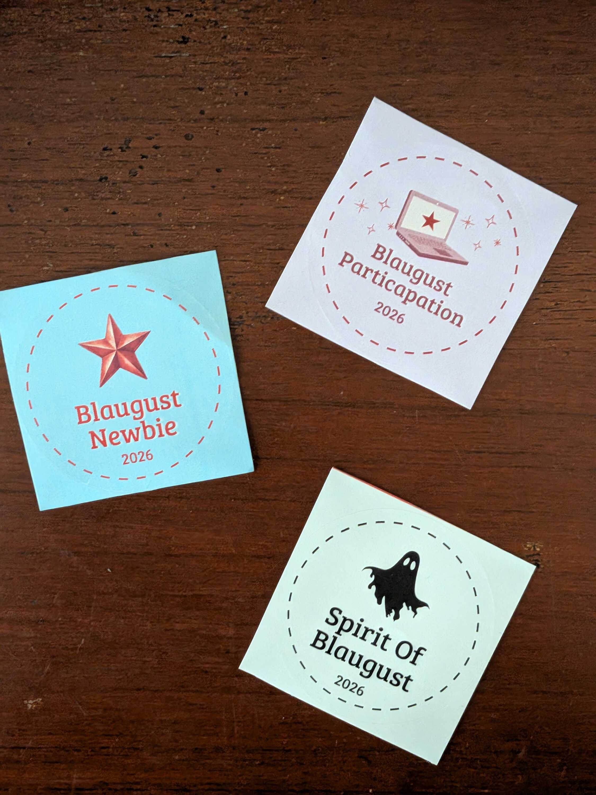
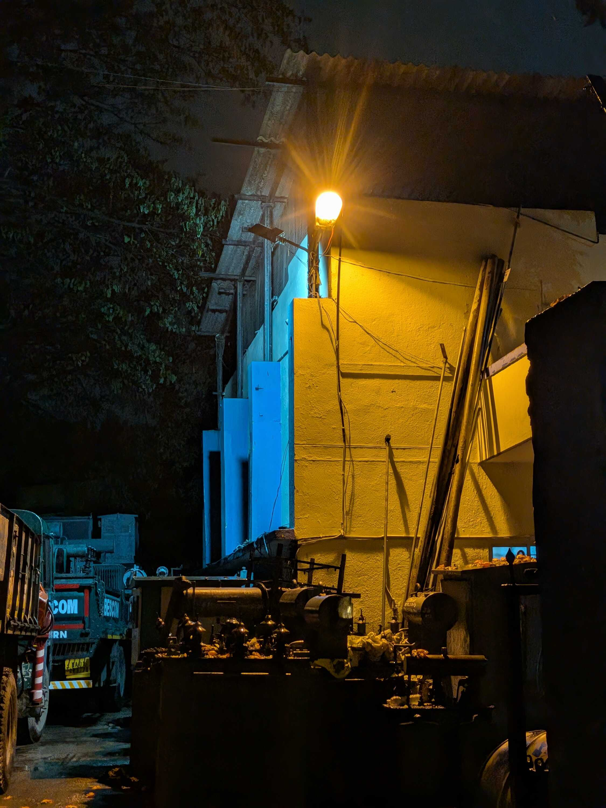

I have some news to share with you. The _chai_ flask in my office finally got fixed this week.

For months I'd been pressing the pump flask repeatedly. Four, five, even six pumps to get a full cup of _chai_. More if the flask was near empty. But now, with a new flask that has an "OK Tested" sticker at the top, I give the pump two gentle pushes and the cup is full of _chai_. I couldn't be happier.

So yeah anyway, the rest of the week probably doesn't hold a candle to that.

Nevermind, it does. I went to my aunt's this week after a long time, with a cake and some candles to celebrate birthdays and anniversaries that had come by and gone. I got to spend time with my cousins and catch up with my uncle too. And the cake was delicious.

Speaking of cake, I have also been experimenting with sweets I can have that aren't loaded to the brim with sugar. I had some _Jaggery Kaju Katli_ which was okay, and some _Chocolate Burfi_ which was so good that I probably shouldn't buy any (because I'll finish them way too quickly). The current ongoing experiment is a _Besan Laddoo_ that uses plant-based sweeteners, so I'll see how that goes. I thought normal sugar was also plant-based only.

I spent many nights playing video games with <abbr title="My friends from college, where most of the group is Marathi. I don't really know how we ended up on that term, but that's how we refer to the group now.">Marathi Gang</abbr> this week. I was recalling how, when I asked my parents for a gaming console in school, they would give me examples of their friends who only bought consoles once they were working individuals. "Now is the time for you to focus on your studies. Once you have a job, you'll have the freedom to play games whenever you want."

It feels a little weird standing on the adult side now, with Steam installed on my laptop and a debit card in my name. The library of games is endless, and so is the stream of recommendations. I'm facing proper paradox of choice, to the point that I'd like to just not game and do something else instead. But I also get to play games with friends from time to time, which is always fun.

Saturday was a day for [IndieWebClub](https://blr.indiewebclub.org). I only realized upon reaching that it was a co-working session this time; nowadays I just buy the ticket and show up.

I helped set up [Gautham's website](https://antiaristotle.blog) and discussed many different things with the IndiePeople. There's always so many new topics to learn about. I've made some changes to my own website too this past week -- there's now an option to view individual posts in a non-doodly font, as well as download them offline as PDF's. The number of regular readers here is a cozy few, but it's always to give them more ways to read.

[Aeishna](https://aeish-world.neocities.org/) also brought in the medal stickers for [Blogust 2026](https://indiecator.org/2026/07/20/blaugust-2026-is-coming/), which was really exciting. There were so many different designs and achievements. I took a few (including "Particapation" heheh) which I'm proud of. You can read more about the individual achievements [in her blogpost](https://aeish-world.neocities.org/blog_pages/blog-blogust-hype).

The IndieDiscussions continued into Tanjore, and then into Samosa Party. After a long talk over _chai_, the remaining bunch marched on -- half-drenched in the rain -- to Ondu Plate for softies.

We carried on talking about many different topics, as the rain subsided and the night got colder. I remember shivering at some point and asking the staff to turn the fan off. Even my ceiling fan is on the lowest speed as I write this. I'm gonna have to start wearing a jacket soon.

At around 10PM, we once again shifted places to [Ankur](https://ankursethi.com/)'s. A long discussion about a myriad of things, but mostly about AI and wishing [Tanvi](https://tanvibhakta.in/) was there to share her thoughts too. I had cold pineapple slices after declining them at first, and we all departed once everyone had started yawning.

A good week with some great moments. I can feel myself looking forward to Diwali; more specifically the "going home" aspect of it.

Much peace and much love.

### Videos I Liked

- "[the best synth of all time is a singing monk](https://www.youtube.com/watch?v=ULbuiQGeIAU)" by [Synthet](https://www.youtube.com/@synthet7)
- "[Car Alarm (extended reprise)](https://www.youtube.com/watch?v=jcutNFPwXPE)" by [pat's soundhouse](https://www.youtube.com/@patuwik)
- "[Round HiFi](https://www.youtube.com/watch?v=8fl2xSBhkkM)" by [Posy](https://www.youtube.com/@PosyMusic)
- "[How to rage bait Americans](https://www.youtube.com/watch?v=zCvPPaIN5Ew)" by [Christophe](https://www.youtube.com/@Christophe)

### Posts I Loved

- "[I have a hard time recognising faces](https://rithvikupadhya.com/blog/face-blindness)" by [Rithvik Upadhya](https://rithvikupadhya.com/)
- "[What's in a name?](https://tanvibhakta.in/blog/whats-in-a-name/)" by [Tanvi Bhakta](https://tanvibhakta.in/)
- "[Thejesh Gangaiah Nagarathna](https://thejeshgn.com/2026/10/17/thejesh-gangaiah-nagarathna/)" by [Thejesh GN](https://thejeshgn.com/)
- "[An Ethnographic Study of my Darling Children](https://rohanparanjpe.substack.com/p/an-ethnographic-study-of-my-darling)" by [Rohan Paranjpe](https://substack.com/@rap2363)
- "[Why I Write](https://blog.skaup.co/why-i-write.html)" by [Saachi](https://blog.skaup.co/)
- "[How To Make Comics Everyday](https://yaoxiaoart.substack.com/p/how-to-make-comics-everyday)" by [Yao Xiao](https://substack.com/@yaoxiaoart)
- "[A History of Menus is a Menu of History](https://pudding.cool/2026/06/menu-story/)" by [Pudding.Cool](https://pudding.cool/)
- "[Reclaiming Friendship: A Visual Taxonomy of Platonic Relationships to Counter the Commodification of the Word 'Friend'](https://www.themarginalian.org/2016/08/16/friendship/)" by Maria Popova at [The Marginalarian](https://www.themarginalian.org/)

### Links I Found Cool

- [TinyLittleOffice.Com](https://tinylittleoffice.com/) (+ [Explanation Post](https://aboard.com/introducing-tinylittleoffice-com/))
- [The RSS Universe -- Readers, Tools and Standards](https://toolbox.rss.here.now/)
- [Felix Rieseberg's Website](https://felixrieseberg.com/?room=1)
