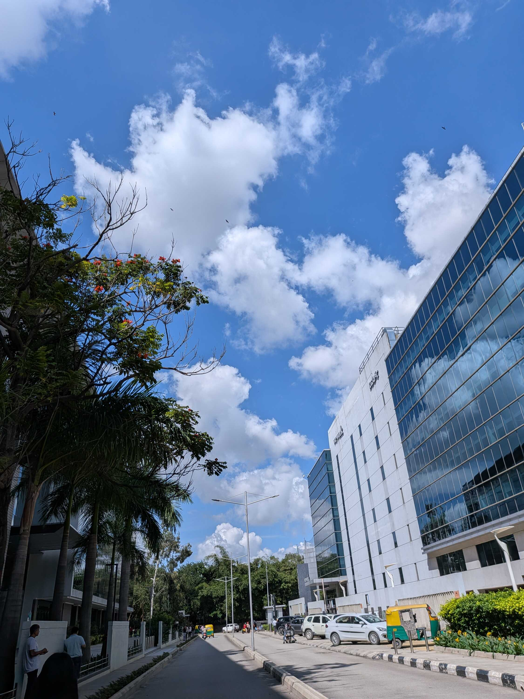
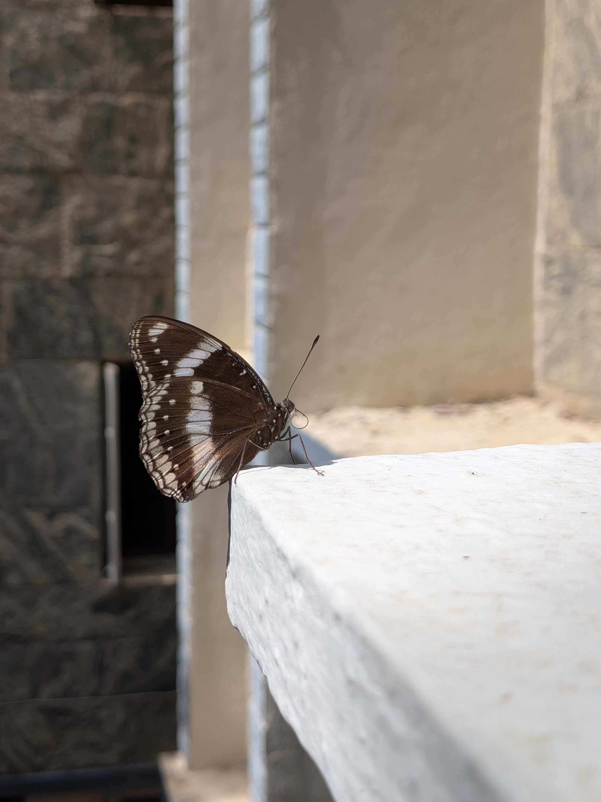
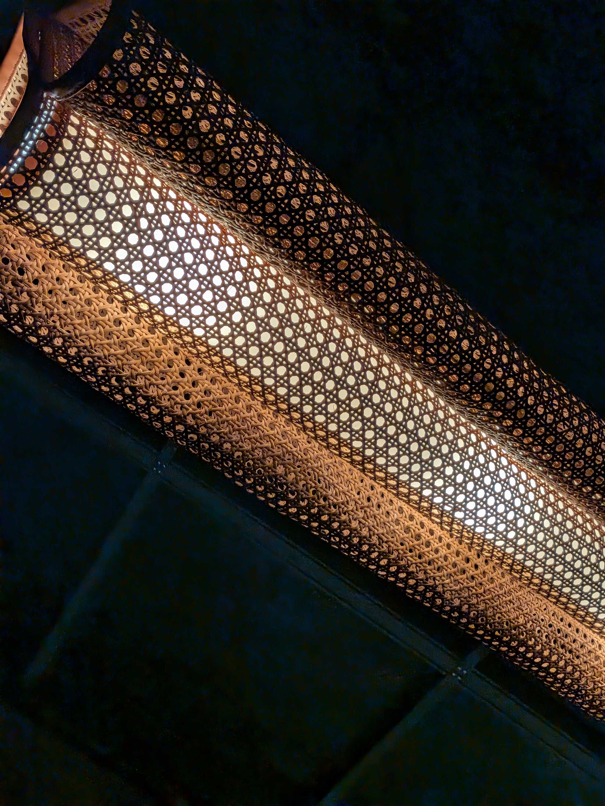

This was one of the longest weeks I have ever experienced, without that much actually happening.

I have been doing something called "Plank Workouts" for a couple months now, to try and mitigate the chronic back pain I've had since January. I started following an app for it, from the same developer that I downloaded "Abs in 30 Days" from during COVID (I was in 10th Grade, can you blame me?).

The progress had been going well and I could feel my core getting stronger. Doing planks at different angles, from side to side, and with an arm or leg off the ground. It was excruciating, but I kept doing it anyway.

On Tuesday, the app presented me with a ridiculous challenge. Two 2.5-minute normal planks, and two 2.5-minute straight arm planks. I kept groaning and whining throughout the regime -- telling myself how insane it is at regular intervals -- until the finishing gong of the exercise sounded. I collapsed on the yoga mat while the app played a cheering sound, promptly followed by an ad.

I'm glad it was Dussehra, because I wasn't able to move for the rest of the day. I kept laying on the bed and ultimately slept for a long time.

When I woke up on Wednesday, I couldn't hear anything from my left ear.

Genuinely, my right ear felt open while my left ear felt like it was against a wall. Slight high-pitched ringing sound on the left. Much questioning panic in my head.

Calls were made to get work-from-home, in case I had to go to the hospital. First call -- as in all urgent scenarios -- was to mom. Questions about the state of the ear and the pain were asked. Context was given about how I exerted myself over planks, which usually causes ear pressure immediately afterward for just a minute. I was hoping this was somehow a late blooming, extended version of that.

After some more questions from mom, the doctor of the family, I was told not to worry about it and just wait. It was some combination of ear pressure and tinnitus, and I just had to stop exerting my ears for a bit. I took some meds as directed and napped in the afternoon. The evening was considerably better.

Thursday was spent in a daze, mental huffing after the mind-racing yesterday. I ended up receiving my MacBook at work in the evening, something I'd been anticipating for a couple months now. But I couldn't think about it too much. I just came back to the room and slept.

Friday, then, was spent being grateful for the ability to hear (touchwood). I'd been really worried about how I'd listen to music, so there was a mini-celebration by listening to Green Day and Oasis. Then came the speedy set-up of the MacBook, and the realization that I was _very_ irritated by the software. I have a rant about it drafted away, though I'm actually coming around to the experience.

The weekend was a dinner at Brooks & Bonds with friends, with the aim to try out the "signature" Mango Beer. When we were planning the outing, [Raghav](https://alphaspiderman.dev/?ref=abhi.now) had quipped that the beer was just Frooti in disguise, but we'd ignored him and gone anyway.

Once we sat down, we were presented with two very mango-juice-looking glasses in front of us. After clinking the glasses and taking considerate sips, we came to our own unique and unadulterated revelation that it was just Frooti and soda.

The dinner was ended with asking a very, very tall bouncer with a ponytail to take our picture. He was very tall. And very intimidating. But he gladly took our picture. We all said our goodbyes after some ice-cream, and I pulled my jacket around me as the night air got colder and I waited for my cab.

Last Sunday feels like ages ago, but I'm just grateful to _be_ right now. Peace and love.

### Videos I Liked

- "[Tutankhamun reacts to ‘pyramids’ by Frank Ocean](https://www.youtube.com/watch?v=ldXXJR_FmiE)" by Auden Barnes
- "[Rhett, Link, & Stevie Go Camping](https://www.youtube.com/watch?v=z8KyyEvd6iw)" by Good Mythical MORE
- "[A Quick One Before the Eternal Worm Devours Connecticut - Have A Nice Life (piano cover)](https://www.youtube.com/watch?v=aQrz-URrf88)" by [LSEG](https://www.youtube.com/@lseg2752)
- "[Delay Lama & Meowsynth](https://www.youtube.com/watch?v=proM3Sj6boQ)" by Louie Zong

### Posts I Loved

- "[Sun signs, moon signs, street signs](https://indiastreetlettering.com/blog/sun-signs-moon-signs-street-signs/)" by [Pooja Saxena](https://anexasajoop.in/) on [India Street Lettering](https://indiastreetlettering.com/)
- "[Why Women Don’t Keep Their Bags in the Overhead Compartment](https://www.shrutisunderraman.com/blog/womenhypervigilance)" by [Shruti Sunderraman](https://www.shrutisunderraman.com/)
- "[A Run to Remember](https://www.roshniranganathan.com/life-blog/a-run-to-remember)" by [Roshni Ranganathan](https://www.roshniranganathan.com/)
- "[Did You Hear About the 100 Minors Who Died in Violence on October 10?](https://blog.learnlearn.in/did-you-hear-about-the-100-minors-who-died-in-violence-on-october-10/)" by [Akshay](https://blog.learnlearn.in/author/akshay/) on [Blissful Life](https://blog.learnlearn.in/)
- "[Solo trip to Jaipur and Ajmer](https://hiran.in/scenes/solo-trip-to-jaipur-and-ajmer/)" by [Hiran Venugopalan](https://hiran.in/)
